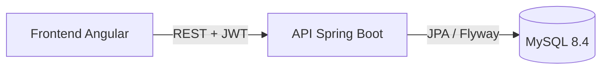

# Planilla de Campo — Backend

API REST para costeo de campañas hortícolas. Permite a un productor registrar costos, cosechas y ventas por lote-campaña, y calcular el margen bruto de cada ciclo productivo.

> Frontend (Angular): [planilla-campo-frontend](https://github.com/rodrigocalizayadev/planilla-campo-frontend)

## Por qué existe

Lo construí para el negocio hortícola de mi familia. Las campañas se costeaban en planillas, mezclando pesos y dólares y con inflación alta, así que al cerrar un ciclo no había forma confiable de saber cuánto había dejado cada lote. Esta app responde esa pregunta: **¿cuánto costó y cuánto ganó cada cultivo en cada lote, en cada campaña?**

## Destacados

- **Dinero modelado como dominio, no como número.** `Monto` es un value object que guarda importe, moneda y tipo de cambio del día, con equivalentes en ARS y USD. Todo en `BigDecimal`. Ver [ADR 0001](docs/adr/0001-value-object-monto.md).
- **Historia inmutable.** Los precios se congelan en cada movimiento, así que actualizar el catálogo no reescribe costos de campañas pasadas.
- **Aislamiento por establecimiento desde el día uno.** Toda consulta filtra por el establecimiento del usuario autenticado, que se resuelve en el servidor y nunca lo envía el cliente. Queda preparado para multi-tenancy sin pagar hoy su complejidad. Ver [ADR 0003](docs/adr/0003-multitenancy-diferida.md).
- **Tests contra una base real.** Tests de integración con Testcontainers sobre MySQL 8.4, incluidas pruebas de migraciones Flyway con backfill de datos históricos.
- **CI/CD.** Cada PR corre `./mvnw verify`. Cada merge a `master` publica la imagen en GHCR y la despliega por SHA. Ver [`docs/despliegue.md`](docs/despliegue.md).



## Cómo se construyó

Lo desarrollé con Claude Code como asistente de programación. El modelo de dominio, las reglas de cálculo y las decisiones de negocio son mías, y salen de conocer el rubro. Cada punto ambiguo que discutí con el agente (cómo tratar los montos multimoneda, si unificar los tipos de movimiento, cuándo encarar la multi-tenancy) quedó registrado como un [ADR](docs/adr/). Así la decisión queda explícita, versionada y es la que guía cualquier cambio futuro. Las reglas que el agente debe respetar están en [`CLAUDE.md`](CLAUDE.md).

## Estado

**MVP funcional de punta a punta** (backend + frontend). Próximos pasos, en orden de prioridad:

1. Presupuesto por campaña y desvío real vs. presupuestado.
2. Maquinaria y herramientas con costo horario de uso.
3. Registro sanitario: monitoreo de plagas y enfermedades vinculado a las pulverizaciones.
4. Multi-tenant real: `Organizacion` sobre `Establecimiento` (ver [ADR 0003](docs/adr/0003-multitenancy-diferida.md)).
5. Carga offline desde el celular, a pie de lote.

---

## Stack

| Componente | Versión |
|---|---|
| Java | 21 |
| Spring Boot | 4.1 |
| Spring Security | 7 (JWT stateless) |
| Spring Data JPA / Hibernate | 7 |
| Jackson | 3 (`tools.jackson.*`) |
| MySQL | 8.4 LTS |
| Flyway | (gestionado por BOM de Boot 4.1) |
| MapStruct | mapper entidad ↔ DTO |
| Testcontainers | tests de integración contra MySQL real |

---

## Levantar el proyecto

**Requisitos:** Docker, Java 21, Maven wrapper incluido.

```bash
# 1. Base de datos
docker compose up -d

# 2. Aplicación (perfil dev)
./mvnw spring-boot:run

# 3. Tests unitarios
./mvnw test

# 4. Tests de integración (Testcontainers levanta MySQL 8.4)
./mvnw verify

# 5. Estado de migraciones
./mvnw flyway:info
```

La app queda disponible en `http://localhost:8080`.  
Health check: `GET /actuator/health`.

---

## Dominio

El sistema modela la producción hortícola (cebolla, zapallo, maíz, melón, sandía). **No es agricultura extensiva de granos**: no hay quintales, silos, humedad de grano ni cosecha mecánica.

La unidad de costeo central es el **lote-campaña**: la intersección de un lote físico, una campaña productiva y un cultivo. Todo costo e ingreso se imputa ahí.

Ver [`docs/dominio.md`](docs/dominio.md) para el glosario completo y las invariantes del modelo.

---

## Estructura de paquetes

Paquetes por feature, no por capa técnica:

```
com.planillacampo
├── config/              configuración transversal
├── shared/              Monto, Moneda, auditoría, excepciones
├── auth/                Usuario, JWT, login/registro
├── establecimiento/     Establecimiento
├── lote/                Lote (parcela física)
├── catalogo/            Cultivo, Insumo, Comprador
├── campania/            Campania, LoteCampania
├── costos/              AplicacionInsumo, Tarea, CostoIndirecto
├── cosecha/             Cosecha por corte y calidad
├── venta/               Venta (precio cerrado y consignación), margen
├── reportes/            Resumen de campaña, costos por rubro, comparativa
└── metadata/            Enums con etiquetas en español
```

---

## API — endpoints principales

**Base URL:** `http://localhost:8080`  
**Auth:** `Authorization: Bearer <token>` en todos los endpoints excepto login y registro.

| Grupo | Qué cubre |
|---|---|
| Auth | Registro (crea el establecimiento), login con JWT y datos del usuario autenticado. |
| Catálogos | Lotes, cultivos, insumos y compradores: CRUD paginado con baja lógica y reactivación. |
| Campañas | Alta, edición, cambio de estado y cierre (solo lectura desde ahí). |
| Lote-Campaña | Lotes de cada campaña, aplicaciones de insumos, tareas, feed de movimientos y desglose de costos. |
| Costos indirectos | Canon de riego, alquileres, etc., prorrateados por hectárea o en forma manual. |
| Cosechas | Cortes por calidad de cada lote-campaña. |
| Ventas | Precio cerrado y consignación, cobros parciales, liquidación por tramos, saldo por comprador y margen. |
| Reportes | Resumen de campaña, costos por rubro y comparativa de un cultivo entre campañas. |
| Metadata | Enums con sus etiquetas en español. |

Referencia completa de rutas, requests y responses en [`docs/api-endpoints.md`](docs/api-endpoints.md).

---

## Convenciones clave

- **`Monto`** es un value object con `importe`, `moneda`, `tipoCambio`, `importeUsd` e `importeArs`. Todo importe usa `BigDecimal`. Nunca `double` ni `float`.
- Los **precios se congelan en el movimiento**: modificar el catálogo no altera costos históricos.
- **Toda consulta filtra por `establecimientoId`**, resuelto desde el usuario autenticado. Ningún endpoint acepta el establecimiento del cliente.
- Los **controllers nunca exponen entidades JPA**: siempre DTOs como `record`.
- **Flyway siempre**: `ddl-auto: validate`. Las migraciones aplicadas no se editan.
- Listados paginados con `Pageable`. Los campos `null` se omiten del JSON (`NON_NULL` global).
- Errores con formato uniforme: `{ timestamp, status, code, message, details[] }`.

---

## Documentación

| Archivo | Contenido |
|---|---|
| [`docs/dominio.md`](docs/dominio.md) | Glosario, semántica del negocio, invariantes |
| [`docs/reglas-calculo.md`](docs/reglas-calculo.md) | Fórmulas de costo y margen + ejemplo canónico |
| [`docs/modelo-datos.md`](docs/modelo-datos.md) | Entidades, tipos, constraints, índices |
| [`docs/plan.md`](docs/plan.md) | Slices verticales de desarrollo |
| [`docs/api-endpoints.md`](docs/api-endpoints.md) | Referencia completa de endpoints y shapes |
| [`docs/adr/`](docs/adr/) | Decisiones de arquitectura |
| [`docs/despliegue.md`](docs/despliegue.md) | CI/CD, servidor de producción, rollback |
